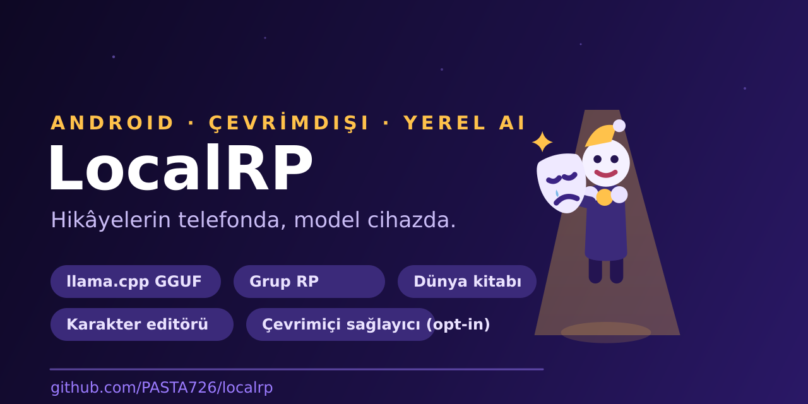

<div align="center">
  

[](https://github.com/PASTA726/localrp/actions/workflows/ci.yml)
[](https://github.com/PASTA726/localrp/releases)
[](LICENSE)


*Hikâyelerin telefonda, model cihazda, veri sende.*

**[Türkçe](#özellikler)** · [English](#english-summary)

</div>

---

**LocalRP**, GGUF modellerle **tamamen çevrimdışı** çalışan, Türkçe arayüzlü bir Android roleplay uygulamasıdır. Karakterlerini oluşturur, tek veya çok karakterli grup hikâyeleri kurarsın; çıkarım llama.cpp ile telefonda çalışır, sohbetlerin ve karakterlerin cihazda kalır.

> *LocalRP is an offline-first, Turkish-language Android roleplay app running GGUF models locally (llama.cpp). Everything stays on-device.*

## Özellikler

### 🎭 Karakter ve hikâye
- **Karakter editörü** — ad, tanıtım, kişilik, sistem talimatı, örnek diyaloglar, avatar.
- **Grup RP** — her karaktere ayrı prompt; sıra döngüsü, ad geçince konuşma, elle sabitlenen konuşmacı, zincir limitleriyle kontrolsüz üretim döngüsünün önü kesilir.
- **Dünya kitabı (lorebook)** — anahtar kelime → olgu kayıtları; son mesajlarda anahtar geçerse prompta yazılır.
- **Sohbet profili** — sohbet başına token bütçesi, geçmiş derinliği ve sahne teması.

### 🤖 Yerel AI (varsayılan)
- **llama.cpp GGUF** motoru, `arm64-v8a`; çıkarım tamamen cihazda.
- **Model kataloğu** — SHA-256 doğrulamalı https indirme, **yarıdan devam** (HTTP Range), depolama kontrolü, cihazına göre *sığar/sınırda/zor* fizibilite etiketleri.
- Kendi `.gguf` dosyanı da kopyalayıp kullanabilirsin.
- **Görsel üretim** — safetensors model kataloğuyla sohbet içinde yerel görsel üretimi.
- Üretim ölçümleri: süre / token / tok-s / bağlam doluluk %; cihaz hız testi (`bench`).

### 🌐 Çevrimiçi sağlayıcı (opsiyonel, opt-in)
- OpenAI-uyumlu **https** endpoint; API anahtarı **AndroidKeyStore** ile kriptolu saklanır, yedeklerde taşınmaz.
- Varsayılan **kapalı** gelir; açık olmadan hiçbir veri dışarı çıkmaz. Kapalıyken davranış saf çevrimdışıdır.

### 🛠 Uygulama
- **6 GUI teması** — Lavanta, Okyanus, Orman (açık) · Gölge, Deniz Gecesi, Gün Batımı (koyu); koyu paletlerde karanlık açılış ekranı.
- **Yedekleme/geri yükleme** — `.json` / medyalı `.zip`; seçmeli dışa aktarma; geri alınabilir silme; veri bütünlüğü raporu.
- Uzun sohbetlerde mesaj dilimleme; akış sırasında tek balonda büyüyen yanıt; her an **durdur** düğmesi.

## Kurulum

### Hazır APK (önerilen)
1. [Releases](https://github.com/PASTA726/localrp/releases) sayfasından en güncel pre-release APK'sını indir — **SHA-256 doğrulaması** sürüm notlarında yayınlanır.
2. Telefona kur (Android 13+ / ARM64).
3. Uygulamada model önerileri ekranından bir GGUF model indir (öneri: `Llama-3.2-1B Q4_K_M`, ~0,8 GB), sonra **Modeli yükle**. İndirme yarıda kesilirse kaldığı yerden devam eder.

### Kaynaktan derleme
Ön koşullar: JDK 17, Android SDK (Platform 36, Build-Tools 36.0.0). Repo, Gradle **8.13**'e sabitlenmiş wrapper ile gelir; motor bağımlılığı [`com.arm:ai-chat:0.1.0`](https://github.com/arm/ai-chat) (Apache-2.0) Maven Central'dan çözülür.

```bash
./gradlew :app:assembleDebug
adb install -r app/build/outputs/apk/debug/app-debug.apk
```

## Gizlilik

- Sohbet, karakter ve dünya kitabı verileri `SharedPreferences` + uygulama içi dosyada saklanır; hiçbir sunucuya gitmez.
- İnternet izni yalnızca **model indirme** ve açıkça etkinleştirilmiş **çevrimiçi sağlayıcı** için kullanılır.
- API anahtarları APK'ya gömülmez, düz metin diske yazılmaz, yedeklere taşınmaz.
- Paketli motorun ve katalog modellerinin lisans bildirimleri: [`THIRD_PARTY_NOTICES.md`](THIRD_PARTY_NOTICES.md).

## Durum

| | |
|---|---|
| Sürüm | v0.21.00-alpha1 (versionCode 54) — tüm sürümler pre-release |
| Testler | 169 JVM birim testi, 0 hata; CI her push'ta yeşil |
| Mimari | Native Kotlin + Java, AndroidX/Room yok; saf views + SharedPreferences |
| Yapay zekâ | llama.cpp (GGUF, arm64) yerel; OpenAI-uyumlu sağlayıcı opt-in |
| Bekleyen | Sağlayıcı akışının gerçek cihazda uçtan uca kabul turu |

## English summary

LocalRP is an offline-first Android roleplay app (Turkish UI). Build characters, run one-on-one or multi-character group stories with per-character prompts, a keyword→fact lorebook and per-chat generation profiles. Inference runs fully on-device via llama.cpp (GGUF, arm64); models install through a SHA-256-verified in-app catalog with resumable downloads. An OpenAI-compatible online provider exists but is strictly opt-in (https-only, AndroidKeyStore-encrypted key) and off by default. Backups export to `.json`/`.zip`; deletes are undoable; 169 JVM unit tests pass on every push. Characters import/export as SillyTavern-compatible V2 cards (PNG with embedded JSON or plain JSON).
